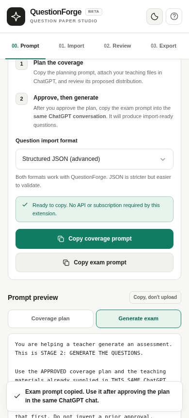
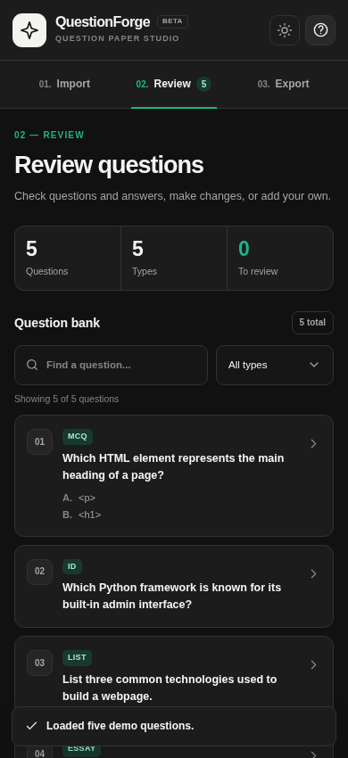
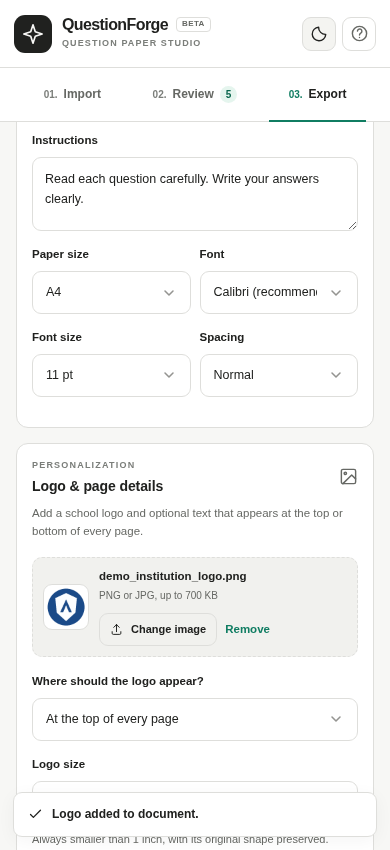

<div align="center">
  

  # QuestionForge

  **Good questions deserve a well-made paper.**

  A free, local-first Chrome extension for planning assessments, reviewing questions, and preparing print-ready Word and PDF documents.

  **Manifest V3** · **Chrome 131+** · **Vanilla JavaScript** · **Local-first**

  [Website](https://questionforge-phi.vercel.app/) · [Getting started](#getting-started) · [How it works](#how-it-works) · [Project structure](#project-structure) · [Security](#security-and-privacy)
</div>

---

> **Release status:** QuestionForge **v0.8.4** is distributed as a production-packaged developer preview. It is **not a Chrome Web Store listing**. This repository concerns the **extension**, not the separately maintained public website. The public download contains the packaged runtime, **not the complete editable development source**.

## Overview

QuestionForge helps educators turn reviewed teaching materials and prepared questions into usable assessments. It combines a guided, source-aware prompt workflow with a question editor and document layout tools in a Chrome side panel.

**QuestionForge does not run its own AI model or require an AI API key.** It can prepare prompts to use with ChatGPT, but the user decides what text to share, reviews the responses, and imports the resulting questions. QuestionForge then handles validation, editing, and document preparation locally.

### What it can do

- **Prepare from teaching materials:** Work with lesson plans, Budget of Work (BOW), Table of Specifications (TOS), curriculum guides, and other supported sources.
- **Inspect extracted content:** Review imported paragraphs, worksheets, tables, and source metadata before using them in prompts.
- **Plan coverage first:** Generate a structured coverage-planning prompt, approve the plan, and prepare the exam-generation prompt.
- **Import generated assessments:** Use structured JSON or supported question text, then check for parsing and validation issues.
- **Review every question:** Edit question wording, choices, answers, types, and points before publishing an assessment.
- **Control the layout:** Configure institutional details, headings, typography, margins, page sizes, question columns, and answer keys.
- **Export locally:** Download editable **Word (`.docx`)** output or use Chrome's **Print → Save as PDF**.
- **Work without a QuestionForge account:** No developer-operated cloud account or backend is needed for core document preparation.

Supported question types include **multiple choice, identification, enumeration, essay, and true/false**.

### Interface previews

| Prepare a prompt | Review questions | Export a paper |
| :---: | :---: | :---: |
|  |  |  |

*Preview assets belong to the development repository; they are not required in the production extension package.*

## Getting started

### Requirements

- **Google Chrome 131 or later** on a desktop computer.
- Permission to enable **Developer mode** for a local unpacked extension.
- A release ZIP downloaded from the official QuestionForge website, or access to this extension's development files.

No server, AI API key, or browser account for QuestionForge is required. Node.js is used for developer checks and tests, not for normal use of a packaged extension.

### Install the production release

1. Download the current **QuestionForge production ZIP** from the [official website](https://questionforge-phi.vercel.app/).
2. Extract it to a permanent folder on your computer.
3. In Chrome, open `chrome://extensions`.
4. Turn on **Developer mode**.
5. Select **Load unpacked** and choose the extracted `questionforge-extension` folder **containing `manifest.json`**.
6. Pin QuestionForge in Chrome and open its side panel.

**Important:** Chrome's *Load unpacked* feature uses an extracted **folder**, not the ZIP itself. Only install an extension obtained from a source you trust, and inspect the requested permissions.

### Run the development version

From the editable extension source folder:

```bash
npm run check
npm test
```

Then load the development folder containing `manifest.json` through `chrome://extensions` using the same unpacked-extension steps above. After code changes, reload the extension on that page and reopen the side panel.

The scripts above are confirmed in an earlier source snapshot. If the current private branch changes its `package.json`, follow the scripts defined there.

## How it works

```text
Teaching materials or existing questions
                |
                v
      01 · Prepare prompts
       - Review source data
       - Plan question coverage
       - Copy prompts to ChatGPT (optional)
                |
                v
      02 · Review questions
       - Import structured JSON or text
       - Check answers, counts, and types
       - Edit or add questions
                |
                v
      03 · Export documents
       - Choose school details and layout
       - Download Word / Print to PDF
```

The extension does **not** automatically send teaching files to ChatGPT. If the user chooses to paste content into ChatGPT or another external service, the shared content is governed by that service's policies.

## Project structure

The **editable source layout** below is based on the available QuestionForge source snapshot; the exact file inventory may evolve with newer private builds. The public production ZIP intentionally has a much smaller structure.

```text
questionforge-extension/
├── manifest.json            # MV3 manifest, permissions, side-panel entry
├── sidepanel.html            # Side-panel HTML shell
├── app.js                    # App UI and user workflows
├── background.js             # MV3 service worker and context-menu actions
├── styles.css                # Application styles and themes
├── package.json              # Development checks and test scripts
│
├── lib/                      # Editable application modules
│   ├── model.js              # Question models, types, validation
│   ├── parser.js             # Text/JSON question parsing
│   ├── prompt-builder.js     # Guided prompt composition
│   ├── source-extract.js     # Local source-file extraction
│   ├── structured-source.js  # Structured source handling
│   ├── xlsx-extract.js       # Workbook extraction
│   ├── source-metadata.js    # Source metadata helpers
│   ├── source-packets.js     # Large-source packet handling
│   ├── docx-export.js        # Editable Word export
│   ├── print-export.js       # Browser print/PDF export
│   ├── page-layout.js        # Shared page geometry
│   ├── ooxml-zip.js          # Bounded Office archive reader
│   ├── zip.js                # ZIP creation helpers
│   ├── document-utils.js     # Document formatting helpers
│   ├── privacy.js            # Local storage/privacy utilities
│   └── donation.js           # Optional donation configuration
│
├── assets/                   # Icons, branding, authorized QR assets
├── docs/                     # Extension-bundled info, privacy, contact pages
├── examples/                 # Sample prompts and assessment fixtures
├── previews/                 # README screenshots and UI previews
├── tests/                    # Node.js regression and security tests
├── configure_gcash_qr.py     # QR asset configuration utility
└── README.md
```

### Main runtime files

| File | Responsibility |
| --- | --- |
| `manifest.json` | Declares the extension's identity, permissions, side panel, and CSP. |
| `sidepanel.html` | Loads the side-panel application. |
| `app.js` | Coordinates the user interface and workflows. |
| `background.js` | Registers browser-side actions such as context-menu capture. |
| `styles.css` | Controls the extension UI, including light/dark presentation. |
| `lib/` | Holds the editable parsers, source processing, validation, and exporters. |
| `assets/` | Stores product identity, icon, and optional local payment assets. |
| `tests/` | Contains development-only automated tests and fixtures. |

### Production distribution layout

The **verified v0.8.4 production ZIP** contains a `questionforge-extension/` folder with the packaged runtime:

```text
questionforge-extension/
├── manifest.json
├── sidepanel.html
├── app.js
├── background.js
├── styles.css
├── assets/
│   ├── brand-mark-{light,dark}.svg
│   ├── brand-wordmark-{light,dark}.svg
│   ├── icon16.png · icon32.png · icon48.png · icon128.png
│   ├── gcash-receive-qr.png
│   ├── gcash-receive-card.png
│   └── *.sha256
└── docs/
    ├── index.html
    ├── contact.html
    ├── privacy.html
    ├── legal.css
    └── brand-mark.svg
```

The release excludes the editable `lib/` modules, `tests/`, examples, source maps, and development tooling. **Minification does not make distributed JavaScript secret:** packaged browser code remains inspectable. Keep proprietary logic, secrets, and signing credentials out of public artifacts.

## Supported source files and limitations

| Source | Supported use | Important limitation |
| --- | --- | --- |
| DOCX | Paragraphs and reviewable table structures | Verify complex tables, images, and equations against the original. |
| XLSX | Worksheets, cell positions, and table regions | Formula calculation and all Excel formatting are not reproduced. |
| CSV | Rows, columns, quoted values | Check column meaning and data units. |
| TXT | Plain text and paragraphs | Encoding and content need human review. |
| Text-based PDF | Extract some selectable text | **No automatic OCR** for scanned PDFs; complex reading order can fail. |

QuestionForge can help structure and format assessments, but **does not guarantee that AI-generated questions or extracted source data are factually correct**. The teacher remains responsible for content accuracy, appropriate difficulty, and answer-key review.

## Security and privacy

QuestionForge follows a local-first approach:

- Supported files are processed in the browser rather than sent automatically to a QuestionForge-operated backend.
- Copying prompts or source content to ChatGPT or another provider is an explicit user action.
- Optional saved drafts/preferences can use Chrome extension storage. **Do not assume saved drafts are encrypted by QuestionForge.**
- The Manifest V3 Content Security Policy restricts extension scripts and remote resources.
- Office-file extraction includes safeguards for suspicious archives, but no parser is guaranteed to be vulnerability-free.
- GCash donations are **optional**; no QuestionForge feature is locked behind a contribution. Verify the recipient inside GCash before transferring money.
- Never submit sensitive student records, credentials, PINs, OTPs, or confidential answer keys in issue reports.

### Browser permissions

| Permission | Why it is used |
| --- | --- |
| `sidePanel` | Provides the QuestionForge interface inside Chrome's side panel. |
| `contextMenus` | Lets users send selected webpage text to the extension via a context-menu action. |
| `storage` | Supports local preferences, optional drafts, and temporary captured selections. |

Permission descriptions are based on the verified v0.8.4 manifest. Review permissions whenever the manifest changes.

For vulnerability reports, use a **private contact channel** from the website rather than posting a working exploit or private files in a public issue.

## Development and validation

The source repository uses native JavaScript modules and Node's built-in test runner; no React or frontend framework is needed for the extension UI.

```bash
# Check JavaScript syntax
npm run check

# Run automated tests
npm test
```

Before releasing, also test manually in a clean Chrome profile:

- Side-panel navigation, theme contrast, keyboard interaction, and context-menu capture.
- DOCX/XLSX/CSV/TXT/PDF imports, including malformed and scanned-document cases.
- Prompt generation, question import, answer validation, and editor behavior.
- Word export and Chrome Print → Save as PDF, with different page layouts.
- Privacy controls, draft deletion, and clearing stored data.
- GCash recipient verification (if a donation QR is included).

## Releases and repository separation

QuestionForge maintains **two separate concerns**:

| Extension repository | Public website repository |
| --- | --- |
| Editable extension implementation, tests, and release preparation | Product landing page, documentation, support, and legal information |
| Source code stays private unless intentionally published | Hosts only the distributable, minified extension ZIP |
| Produces a tested release artifact | Publishes the verified artifact and its SHA-256 checksum |

**Release checklist**

1. Update `manifest.json` version and review permissions, privacy, and functionality.
2. Run `npm run check`, `npm test`, and clean-profile manual testing.
3. Use the project's **verified private packaging workflow** to generate the minified production ZIP. Do not publish raw development files or source maps.
4. Inspect the ZIP's contents and confirm `manifest.json` is at the root of the extracted loadable folder.
5. Compute its SHA-256 checksum, for example on Windows PowerShell:

   ```powershell
   Get-FileHash .\QuestionForge-v0.8.4-production.zip -Algorithm SHA256
   ```

6. Verify download, install, and core flows from the exact release ZIP.
7. Update the public website's download link, checksum, version details, and any affected legal/help pages.
8. Keep the authorized GCash QR fingerprint in a separate, trusted location and monitor the live website independently.

**Note:** No current private build command has been independently confirmed here, so this README intentionally does not invent one. If the repository has a packaging script, document its actual name and required options.

## Support and project status

- **Website and releases:** [QuestionForge](https://questionforge-phi.vercel.app/)
- **Developer:** [GitHub profile](https://github.com/xf00889)
- **Contact:** [hutchiejn@gmail.com](mailto:hutchiejn@gmail.com)

QuestionForge is an independent project and is **not affiliated with or endorsed by OpenAI, Google, or GCash**.

## Source availability

This project is **not presented as open source**. The editable development code is maintained separately from the public production download. Unless a separate license explicitly grants permission, do not assume that access to the repository or packaged extension grants rights to modify or redistribute the source.

---

<div align="center">
  <sub>QuestionForge · Prepare thoughtfully. Review carefully. Export confidently.</sub>
</div>
